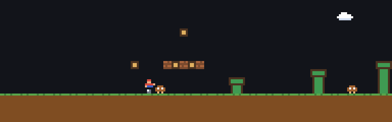
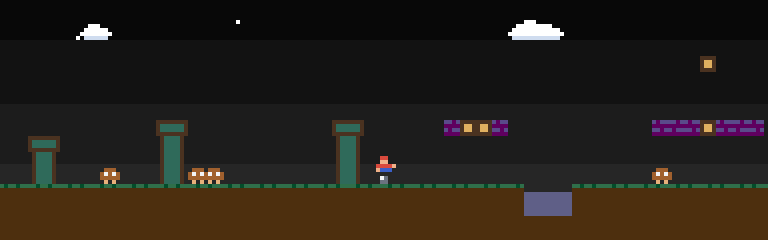

# super_mario

终端里的超级马力欧：单机、离线的横版动作游戏，用字符像素在终端里画出来，还自带一个浏览器关卡编辑器。





## 特性

- **原版手感**：走跑两档、滑行转向、可变跳跃高度，固定 60 Hz 定点数物理，同样的输入必然同样的结果
- **八个内置关卡**：每关一个场景、一种玩法，见下表
- **敌人与道具**：蘑菇怪、乌龟、龟壳连锁；蘑菇、星星、1UP、金币
- **关卡编辑器**：浏览器里画关卡、即时试玩、保存后直接出现在游戏的选关列表
- **关卡外观**：8 套主题，天空、地面、砖块、水管都能换色；夜晚有闪烁的星空
- **排行榜**：前十名，记录分数、用时和日期
- **终端适配**：真彩 / 256 色 / 单色 / ASCII 四档降级，四档缩放

## 快速开始

```bash
make build
./build/super-mario.exe
```

没有 `make` 也可以直接 `go run ./cmd/super-mario`（这样编辑器不可用，见下文）。

标题菜单：开始游戏、选择关卡、设计关卡、排行榜、操作说明。

## 关卡

| 关 | 场景 | 玩法 |
|---|---|---|
| 1-1 | 草原 | 入门：水管、断层、阶梯、问号块 |
| 1-2 | 地下 | 低矮的砖块走廊里踢龟壳，砖顶上还有一条近道 |
| 1-3 | 黎明 | 没有地面，只有石柱和悬空平台 |
| 1-4 | 熔岩城堡 | 岩顶压着头跳熔岩坑，最后过有乌龟守着的砖桥 |
| 2-1 | 雪原 | 一路往上爬：石柱、砖塔、高台阶 |
| 2-2 | 沙漠 | 乌龟排在蘑菇怪群前，踢壳连锁清场 |
| 2-3 | 黄昏 | 断断续续的长桥，只有 100 秒 |
| 2-4 | 夜晚 | 敌人成群，抢星星冲过去；暗处有隐藏块 |

“开始游戏”从 1-1 开始，其他关在“选择关卡”里。

## 按键

| 动作 | 按键 |
|---|---|
| 移动 | `←` `→` |
| 跳跃 | `空格` / `Z` / `↑` |
| 加速跑 | `Shift` / `X`（有的终端吞掉 Shift+方向键，就用 X） |
| 暂停 | `Esc` / `P` |
| 退出 | `Q` |

## 参数

| 参数 | 说明 |
|---|---|
| `-level <文件>` | 直接玩某个关卡文件 |
| `-theme ink\|paper` | 深色（默认）或浅色界面 |
| `-scale tiny\|wide\|mid\|native` | 缩放；越大越清晰、视野越小 |
| `-fps <n>` | 渲染帧率，默认 30（物理恒为 60 Hz） |
| `-noairjump` | 关闭空中二次跳（本作默认开启，原版没有） |
| `version` | 打印版本号 |

终端建议至少 80×24，需要支持 `▀` 字符（不支持时退回 ASCII）。

## 设计关卡

在标题菜单选“设计关卡”，或者：

```bash
./build/super-mario.exe edit
```

浏览器会打开编辑器，界面可切换中文 / 英文：

- 画笔、矩形、橡皮、选择、框选复制，水管 / 阶梯 / 坑等图章，一键铺地面
- 问号块里放什么可以指定，也可以按权重随机
- 整关主题和各元素配色
- `Enter` 立刻试玩，用的就是游戏本体；边画边检查，有问题会提示
- 按 `?` 看全部快捷键

**关卡存在哪：**

| 目录 | 用途 |
|---|---|
| `pkg/level/data/` | 内置关卡，编进程序。在仓库里运行时新关卡存这里 |
| 程序旁的 `levels/` | 本地关卡，运行时读取，不用重新编译。分享时把程序和这个文件夹一起拷走 |

自己画的关卡默认不进仓库（只有内置的八关进仓库）。想贡献关卡，看 [CONTRIBUTING-LEVELS.md](CONTRIBUTING-LEVELS.md)。

## 关卡格式

关卡是 JSON，一行一个字符串画地形：

```json
{
  "name": "1-1", "world": "1-1", "width": 186, "height": 15, "timeLimit": 400,
  "meta": {"title": "草原初探", "author": "tom", "difficulty": 1},
  "spawn": {"x": 2, "y": 12},
  "flag": {"x": 169, "topY": 2, "bottomY": 12},
  "rows": ["...地形..."],
  "contents": [{"x": 21, "y": 9, "kind": "mushroom"}],
  "entities": [{"kind": "goomba", "x": 22, "y": 12}]
}
```

| 符号 | 含义 | 符号 | 含义 |
|---|---|---|---|
| ` ` | 空气 | `?` | 问号块 |
| `X` | 地面 | `o` | 金币 |
| `B` | 砖块 | `[` `]` `{` `}` | 水管口 / 水管身 |
| `H` | 硬块（阶梯） | `F` `T` | 旗杆 / 旗杆顶 |

`contents` 是方块里的东西：`coin` / `mushroom` / `star` / `oneup` / `poison` / `gold` / `random`，`count` 是能顶几次，`hidden: true` 是隐藏块。

### 外观

`style` 可选，每项写色板名或 `#rrggbb`：

<!-- style-example -->
```json
"style": {"theme": "snow", "sky": {"top": "#1b2a4a", "bottom": "#f3a65a"}, "brick": "blue", "pipe": "#3a7bd5"}
```

| 项 | 可用名称 |
|---|---|
| `theme` | `grassland` 草原、`dusk` 黄昏、`night` 夜晚、`dawn` 黎明、`snow` 雪原、`desert` 沙漠、`underground` 地下、`lava` 熔岩 |
| `sky` | `day` 白天蓝、`dusk` 黄昏橙、`night` 夜空、`dawn` 黎明粉、`overcast` 阴天灰、`starry` 星空 |
| `ground` | `brown` 棕土、`red` 红土、`gray` 灰岩、`sand` 沙土、`frozen` 冻土、`ash` 火山灰 |
| `turf` | `green` 草地绿、`autumn` 秋草橙、`snow` 雪地白、`sand` 沙漠黄、`amethyst` 紫晶、`ember` 余烬红 |
| `brick` | `red` 红砖、`blue` 蓝砖、`stone` 石砖、`gold` 金砖 |
| `stair` | `gray` 灰石、`sand` 砂岩、`slate` 青石、`ice` 冰块、`obsidian` 黑曜石 |
| `pipe` | `green` 绿、`blue` 蓝、`orange` 橙、`gray` 灰 |

`night` 主题和 `night` / `starry` 天空会出现星空。

## 开发

```bash
make test        # Go 测试 + 编辑器模型测试
make vet         # 静态检查
make e2e         # 编辑器浏览器测试（需要 Chrome 和 Node）
make fmt-levels  # 规整关卡文件排版
make gen-level   # 从 tools/genlevel.py 与 tools/genworlds.py 重新生成内置关卡
```

```
cmd/super-mario   游戏入口和子命令
cmd/wasm          编进浏览器的游戏代码（编辑器用）
pkg/game          物理、碰撞、敌人、道具
pkg/level         关卡解析、校验、外观
pkg/render        终端画面绘制
pkg/editor        关卡编辑器服务和网页
pkg/catalog       内置与本地关卡目录
pkg/save          排行榜存档
```

版本号写在 `VERSION`，规则见 [VERSIONING.md](VERSIONING.md)。

## 已知限制

- 没有音效
- 没有水管子区域和火焰花
- 空中二次跳是本作加的，`-noairjump` 可以关掉
